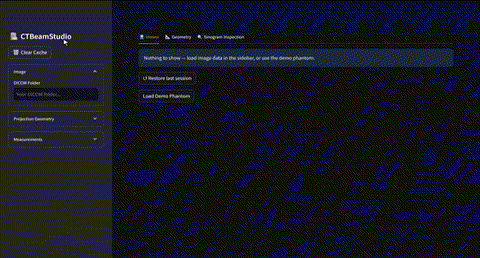

# CTBeamStudio

An open-source, browser-based tool for exploring CT scanner geometry and comparing
**simulated** projections against **measured** ones.

**Core utility:** load a CT volume together with a cone-beam projection geometry,
forward-project the volume to produce *simulated* projections, and compare them
directly against *measured* projection data. That comparison — side by side, as a
difference image, and scored per projection — is the point of the tool: it is how
you check whether a geometry table (SID, SDD, detector offsets, pitch) actually
describes a real acquisition.


**Demo (synthetic phantom):** loading the demo data, toggling 2D/3D views, inspecting
the projection geometry, running the forward projection, and comparing simulated vs.
measured sinograms with MAE/RMSE/SSIM:



## Features

### Simulated vs. measured comparison

- **Three-column view** — measured | simulated | difference, driven by a shared
  projection-index slider
- **Quantitative metrics** — MAE, RMSE and SSIM per projection, metric curves over the
  projection index, and distributions across all projections, so you can see *where*
  the two disagree
- **Beam energy** — sets the Hounsfield-unit → attenuation conversion used for the
  simulation

### Forward projection

- **parallelproj** (Joseph 3D) cone-beam ray tracing, using CUDA when available and the
  CPU otherwise
- **Subset runs** — restrict a run to selected projections, detector rows/columns, or a
  downsample factor
- **Circular and helical** trajectories

### Projection geometry

- **Define, load and edit** — source/detector distances (`SDD`/`SID`), fan and cone
  angle, detector size and shape, offsets, pitch. Geometry is read from YAML or
  Mayo Clinic–style text files; see [docs/geometry.md](docs/geometry.md) for the
  definition.
- **3D visualization** — the volume iso-surface sits inside the gantry, with source,
  detector, isocenter and central beam overlaid, plus the full gantry trajectory.
  Legend entries toggle each layer.

### Volume viewing

- **DICOM Loading** — CT volumes from DICOM series (`.dcm`, `.ima`)
- **Multi-Planar Reconstruction (MPR)** — axial, coronal and sagittal slices with
  isotropic resampling
- **Windowing** — lung, abdomen, bone and brain presets plus manual center/width
- **HU Values** — native Hounsfield Unit handling; windowing only changes the display
- **Demo Phantom** — built-in Shepp-Logan phantom, so the whole workflow runs without
  any patient data

### Engineering

- **362 tests, zero skipped** — no silent gaps in the suite
- **CI** — lint, full test run, and a data guard that fails the build if a DICOM/NPY
  file is ever tracked
- **Docker** — `slim` (viewer only, ~1.43 GiB) and `full` (viewer + parallelproj +
  torch) targets, and a published image

## Status

The full path works end to end: load a volume and a geometry, forward-project it, and
score the result against measured projections. Open work sits on the delivery side
rather than the imaging side — the Docker image is built and published on release, but
not yet on every push, and `main` has no CI gate for the Docker targets yet.

## Supported Data

- **AAPM Low-Dose CT Challenge 2016** — [Download data here](https://aapm.app.box.com/s/eaw4jddb53keg1bptavvvd1sf4x3pe9h/folder/144226105715)
- **Generic DICOM** — Any CT dataset with valid HU values
- **Measured projections / sinograms** — NumPy (`.npy`, `.npz`), NIfTI (`.nii`,
  `.nii.gz`) and DICOM, with lazy subset reads so only the selected projections are
  loaded; the demo also provides a synthetic sinogram

> **Note:** This project does NOT distribute patient data. Users must register separately for the AAPM challenge and use their own licensed data.

> **⚠️ Disclaimer:** This software is intended for **research and educational purposes only**. It is **not** a medical device and has not been reviewed or approved by the FDA, CE, or any regulatory body. Do not use this software for clinical diagnosis, treatment decisions, or any purpose that could affect patient care.

## Installation

For detailed installation instructions, see [INSTALLATION.md](INSTALLATION.md).

### Quick Start

**Docker (Recommended):** pull the published image, or build it yourself.
```bash
docker pull ghcr.io/lhell/ctbeamstudio:1.0.0
docker run -p 8501:8501 -v /path/to/dicom:/data:ro ghcr.io/lhell/ctbeamstudio:1.0.0
```
The image includes parallelproj and torch, so the forward projection works
(point the app at `/data` inside the container). Building locally:
`docker build -t ctbeamstudio:full --target full .` — and
`docker build -t ctbeamstudio:slim --target slim .` builds `slim`
(viewer only, no projection; ~1.43 GiB — see the Dockerfile header for the
size breakdown). To hand the image to a customer:
[docs/customer-docker-guide.md](docs/customer-docker-guide.md).

**Local with pip:**
```bash
pip install -e .
streamlit run src/visualization/app.py
```

**Local with Conda (required for real forward projection):**
```bash
conda env create -f environment.yml
conda activate ct-viewer
streamlit run src/visualization/app.py
```

On Windows, `run_app.cmd` wraps those steps (it activates `ct-viewer` and warns
if parallelproj is missing). Using pip alone is fine for the viewer, but
"Run Forward Projection" then returns zeros.

## Usage

1. **Start the app:** `streamlit run src/visualization/app.py`
2. **Load data:** enter a DICOM folder path in the sidebar, or start without data to
   get the built-in demo phantom
3. **Viewer tab:** scroll through slices, set a window preset, and switch to 3D to see
   the volume inside the gantry with the geometry overlay
4. **Geometry tab:** inspect and edit the projection geometry
5. **Sinogram Inspection tab:** load measured projections (or use the synthetic ones),
   set the beam energy, and optionally restrict the run to a subset of projections,
   rows or columns
6. **Run Forward Projection:** compare measured vs. simulated side by side, read the
   per-projection MAE/RMSE/SSIM, and scrub through the projection index to find where
   the two disagree

## Development

Project code runs in the conda environment `ct-viewer` (parallelproj is conda-forge
only — see [docs/local-environment.md](docs/local-environment.md)):

```bash
python -m pytest -q -rs          # full suite, no skips expected
python -m flake8 . --ignore=F841,E501,E402,F541,F401,W503,E203
python -m black . && python -m isort .
```

`AGENTS.md` documents the conventions, and `docs/plan.md` is the task ledger.

## License

This project is licensed under the MIT License. See [LICENSE](LICENSE) for details.

## Third-Party Licenses

See [NOTICE](NOTICE) for information about third-party components.

## Security

See [SECURITY.md](SECURITY.md) for our security policy and best practices.

## Citation

If you use this software in your research, please cite:

> CTBeamStudio: A visualization tool for CT orientation. 2026.

The forward projection is computed with [parallelproj](https://github.com/KUL-recon-lab/parallelproj).
If you use simulated projections from this tool in your research, please cite the
parallelproj publication as well — the upstream project recommends it:

> Schramm, G. & Thielemans, K. *PARALLELPROJ — an open-source framework for fast
> calculation of projections in tomography.* Front. Nucl. Med. **3**, 1324562 (2024).
> doi:[10.3389/fnume.2023.1324562](https://doi.org/10.3389/fnume.2023.1324562)
> (preprint: [arXiv:2212.12519](https://arxiv.org/abs/2212.12519))

If you use AAPM Challenge data, please also cite the original challenge.
